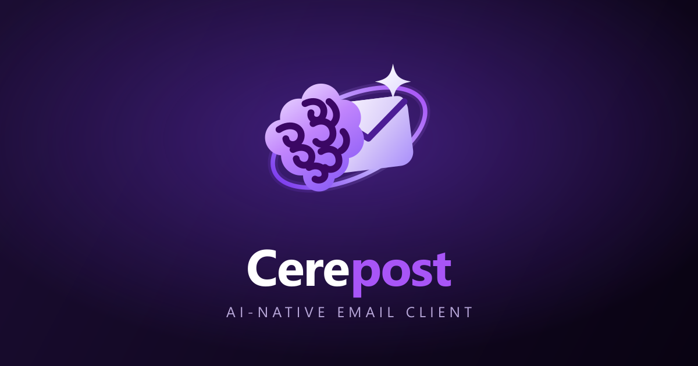

# CerePost

<p align="center">
  <strong>Email rebuilt for speed, intelligence, and zero clutter.</strong><br />
  An AI-native email client with natural-language search, instant drafting, thread triage, and keyboard-first navigation.
</p>

<p align="center">
  <a href="https://nextjs.org"></a>
  <a href="https://react.dev"></a>
  <a href="https://www.typescriptlang.org"></a>
  <a href="https://trpc.io"></a>
  <a href="https://www.prisma.io"></a>
  <a href="https://tailwindcss.com"></a>
  <a href="https://clerk.com"></a>
  <a href="https://ai.google.dev"></a>
  <a href="./LICENSE"></a>
</p>



---

## Overview

**CerePost** is a full-stack, AI-assisted email client built on the T3 stack. It connects to Gmail or Outlook through **Aurinko**, syncs mail into **PostgreSQL**, and layers **Google Gemini** on top for summarization, drafting, autocomplete, and natural-language inbox search.

The app is designed around a keyboard-first, low-clutter workflow:

- Ask questions about your inbox in plain English
- Search by sender, subject, body text, or intent
- Triage threads with done, star, mute, and labels
- Reply, reply all, and forward without leaving the thread
- Compose with AI assistance or inline autocomplete

It works on desktop and mobile, with a dark theme by default and a light theme available.

---

## Features

### 📥 Mailbox & sync
- Gmail / Outlook OAuth linking via Aurinko
- Automatic mailbox deduplication when the same address is linked repeatedly
- Background refresh on app open, tab focus, and every few minutes
- Manual refresh from the account menu
- Thread-based inbox with Inbox, Done, Starred, Drafts, and Sent views
- Account switcher with refresh and sign-out controls

### 🤖 AI assistant
- Chat with an assistant that can use your email context
- One-click AI replies and AI compose
- Tone presets: accept, decline, or ask for details
- Inline **Ctrl/⌘ + J** autocomplete in the composer
- Markdown-rendered assistant responses
- Streaming responses for fast feedback

### 🔎 Search
- Natural-language and semantic search powered by Gemini embeddings + Orama
- Keyword fallback across subject, snippet, sender, and recipients
- Live suggestions for matching emails and people while typing
- Recent-email suggestions on focus
- Keyboard navigation in the suggestion dropdown
- Search results grouped by thread

### 🏷️ Thread actions
- Mark done / undone
- Star / unstar threads
- Mute / unmute threads
- Add and remove labels
- Reply, reply all, and forward
- Rich-text composer with contact autocomplete
- Forwarded-message quoting

### ⌨️ Keyboard-first UI
- `/` — focus search
- `Ctrl/⌘ + K` — command palette
- `Ctrl/⌘ + J` — AI autocomplete while composing
- `j` / `k` — next / previous thread
- `g g` — jump to the first thread
- Command palette actions for navigation, accounts, and theme switching

### 🎨 UI
- Responsive desktop three-pane layout
- Dedicated mobile single-pane inbox with drawer navigation
- Floating **Ask AI** button on mobile
- Dark mode by default, light mode toggle
- Smooth scrolling with Lenis
- Animated landing page with aurora mesh background
- Accessible shadcn/Base UI components

---

## Tech stack

| Layer | Technology |
| --- | --- |
| Framework | Next.js 16 (App Router) |
| Language | TypeScript |
| UI | React 19, Tailwind CSS 4, shadcn-style components, Base UI |
| API | tRPC 11 |
| Database | PostgreSQL |
| ORM | Prisma 6 |
| Auth | Clerk |
| Email provider | Aurinko (Gmail / Outlook) |
| AI | Google Gemini via AI SDK and `@google/genai` |
| Search | Orama + Gemini embeddings |
| State | TanStack Query, Jotai, React hooks |
| Animation | Framer Motion |
| Scroll | Lenis |

---

## Architecture

```text
┌────────────────────────────── Browser ──────────────────────────────┐
│ Next.js App Router · React · tRPC client · TanStack Query · Jotai   │
│ Clerk auth · responsive mail UI · AI composer · search suggestions  │
└───────────────────────────────┬─────────────────────────────────────┘
                                │ tRPC / route handlers
┌───────────────────────────────▼─────────────────────────────────────┐
│ Next.js server                                                      │
│  ├─ Clerk middleware + auth                                         │
│  ├─ tRPC routers (accounts, mail, search, thread actions)           │
│  ├─ Aurinko OAuth + initial sync + delta refresh                    │
│  ├─ Gemini chat, compose, autocomplete and embeddings               │
│  ├─ Orama semantic index (stored per account)                       │
│  └─ Prisma → PostgreSQL                                             │
└─────────────────────────────────────────────────────────────────────┘
```

### Mail sync flow

```text
Clerk sign-in
   ↓
/mail with no linked mailbox
   ↓
Aurinko OAuth (Google/Microsoft)
   ↓
/api/aurinko/callback → store token + account
   ↓
initial sync → threads, emails, contacts
   ↓
delta sync on refresh / focus / interval
```

### Search flow

```text
query
  ├─ lightweight exact-match scan over recent mail
  ├─ Orama semantic / hybrid search when keyword matches are weak
  └─ merge + deduplicate by thread
```

---

## Getting started

### Prerequisites

- Node.js **20+**
- npm **10+**
- PostgreSQL database (local, Neon, Supabase, etc.)
- Clerk account
- Aurinko account
- Google AI / Gemini API key

### 1. Clone and install

```bash
git clone https://github.com/your-username/cerepost.git
cd cerepost
npm install
```

`npm install` runs `prisma generate` automatically.

### 2. Configure environment

Create a local env file:

```bash
cp .env.example .env
```

Fill in the variables below.

| Variable | Required | Description |
| --- | --- | --- |
| `DATABASE_URL` | Yes | PostgreSQL connection string |
| `CLERK_SECRET_KEY` | Yes | Clerk secret key |
| `NEXT_PUBLIC_CLERK_PUBLISHABLE_KEY` | Yes | Clerk publishable key |
| `NEXT_PUBLIC_CLERK_SIGN_IN_URL` | Recommended | Usually `/sign-in` |
| `NEXT_PUBLIC_CLERK_SIGN_UP_URL` | Recommended | Usually `/sign-up` |
| `NEXT_PUBLIC_CLERK_SIGN_IN_FALLBACK_REDIRECT_URL` | Recommended | Usually `/mail` |
| `NEXT_PUBLIC_CLERK_SIGN_UP_FALLBACK_REDIRECT_URL` | Recommended | Usually `/mail` |
| `NEXT_PUBLIC_URL` | Yes | Public app origin used for Aurinko callbacks, e.g. `http://localhost:3000` |
| `NEXT_PUBLIC_SITE_URL` | Optional | Public site URL used for metadata |
| `AURINKO_CLIENT_ID` | Yes | Aurinko OAuth application client ID |
| `AURINKO_CLIENT_SECRET` | Yes | Aurinko OAuth application secret |
| `AURINKO_SIGNING_SECRET` | Optional | Aurinko signing secret for webhook verification |
| `GOOGLE_GENERATIVE_AI_API_KEY` | Yes | Gemini API key used by chat, compose, autocomplete, and embeddings |

> `NEXT_PUBLIC_*` values are embedded at build time. After changing them, rebuild or redeploy.

### 3. Set up the database

```bash
npx prisma generate
npx prisma db push
```

Optional:

```bash
npm run db:studio
```

### 4. Set up Clerk

1. Create a Clerk application.
2. Copy the publishable and secret keys into `.env`.
3. Enable Google (and any other desired) sign-in providers.
4. Set the sign-in and sign-up redirect URLs to `/mail`.
5. If you want Clerk webhooks, point them at `/api/clerk/webhook`.

The Aurinko callback also ensures a matching app user exists, so a webhook is not strictly required.

### 5. Set up Aurinko

1. Create an application in the Aurinko dashboard.
2. Copy `AURINKO_CLIENT_ID` and `AURINKO_CLIENT_SECRET` into `.env`.
3. Register the callback URL **exactly**:
   - Local: `http://localhost:3000/api/aurinko/callback`
   - Production: `https://your-domain.com/api/aurinko/callback`
4. Keep the scheme, host, path, and trailing slash consistent with `NEXT_PUBLIC_URL`.
5. Make sure the Aurinko plan/billing is active; mail sync is blocked without it.

Required mail scopes are configured in code:

```text
Mail.Read Mail.ReadWrite Mail.Send Mail.Drafts Mail.All
```

### 6. Run locally

```bash
npm run dev
```

Open [http://localhost:3000](http://localhost:3000).

---

## Scripts

| Command | Description |
| --- | --- |
| `npm run dev` | Start the Next.js dev server (Turbopack) |
| `npm run build` | Production build |
| `npm start` | Start the production server |
| `npm run preview` | Build and start production locally |
| `npm run lint` | Run ESLint |
| `npm run typecheck` | Run TypeScript checks |
| `npm run db:push` | Push the Prisma schema to the database |
| `npm run db:studio` | Open Prisma Studio |
| `npm run db:migrate` | Deploy Prisma migrations |
| `npm run format:write` | Format with Prettier |
| `npm run format:check` | Check Prettier formatting |

> This project currently uses `prisma db push` for schema management. If you add migration files later, switch to `prisma migrate` workflows.

---

## Project structure

```text
src/
├─ app/
│  ├─ page.tsx                 # Landing page
│  ├─ mail/                    # Inbox app
│  │  ├─ components/           # Mail UI, search, composer, account switcher
│  │  └─ page.tsx              # Mail dashboard entry
│  ├─ api/
│  │  ├─ aurinko/              # OAuth authorize + callback
│  │  ├─ ai/                   # Streaming autocomplete + compose routes
│  │  ├─ chat/                 # AI inbox chat
│  │  ├─ clerk/webhook/        # Optional Clerk webhook
│  │  ├─ initial-sync/         # Initial mailbox sync endpoint
│  │  └─ trpc/                 # tRPC HTTP handler
│  ├─ sign-in/                 # Clerk sign-in
│  └─ sign-up/                 # Clerk sign-up
├─ components/                 # Shared UI, landing background, theme, toasts
├─ hooks/                      # Mail query hooks
├─ lib/
│  ├─ account.ts               # Aurinko sync client
│  ├─ aurinko.ts               # Aurinko HTTP helpers
│  ├─ sync-to-db.ts            # Email/thread persistence
│  ├─ orama.ts                 # Semantic index
│  └─ embeddings.ts            # Gemini embeddings
├─ server/
│  ├─ api/routers/             # tRPC account/mail routers
│  └─ db.ts                    # Prisma client
├─ styles/globals.css          # Tailwind, theme tokens, mail styles
└─ trpc/                       # tRPC client setup
prisma/
└─ schema.prisma               # Users, accounts, threads, emails, labels
```

---

## How it works

### Account linking and deduplication
Aurinko can create a new authorization row every time the same mailbox is linked. CerePost resolves accounts by normalized email address, keeps a single canonical row, merges threads, and promotes a working connection when refreshing.

### Initial sync and refresh
- Initial sync currently requests the **last 3 days** of mail (`daysWithin` in `src/lib/account.ts`).
- Delta sync fetches new updates after that.
- If you need older history, increase the initial sync window or add a backfill flow.

### AI
- Chat: `/api/chat` builds email context and streams a Gemini response.
- Compose: `/api/ai/compose` streams a generated draft.
- Autocomplete: `/api/ai/autocomplete` streams a short continuation, inserted with `Ctrl/⌘ + J`.

### Search
- Orama stores an index per account with text and vector embeddings.
- Search merges exact keyword matches with semantic results and deduplicates by thread.
- Search suggestions use a fast Prisma query over subjects, senders, snippets, and contacts.

---

## Deployment

### Vercel + Neon (recommended)

1. Create a Neon PostgreSQL database and copy its connection string.
2. Import the repository into Vercel.
3. Add all environment variables to the **Production** environment.
4. Set `NEXT_PUBLIC_URL` and `NEXT_PUBLIC_SITE_URL` to the production origin.
5. Register the production Aurinko callback URL.
6. Deploy. `postinstall` runs `prisma generate`.
7. Run the schema push against the production database:

```bash
DATABASE_URL="your-production-url" npx prisma db push
```

> Changing `NEXT_PUBLIC_*` values requires a new deployment. Restarting alone is not enough.

### Production checklist

- Clerk keys are production keys, not development keys
- Aurinko credentials match the production Aurinko app
- Aurinko callback URL matches `NEXT_PUBLIC_URL` exactly
- Aurinko billing/plan is active
- Gemini API key has quota
- Database schema is up to date
- `NEXT_PUBLIC_URL` is an `https://` origin with no trailing slash

---

## Troubleshooting

### `returnurl.invalid`
Aurinko received a callback URL that is not registered for the app. The `returnUrl` sent by the app must exactly match an allowed URL in Aurinko:
- scheme (`http` vs `https`)
- `www` vs apex domain
- path
- trailing slash

### `application.notfound`
Aurinko credentials in the running deployment are wrong, missing, or belong to a deleted/different Aurinko application. Verify `AURINKO_CLIENT_ID` and `AURINKO_CLIENT_SECRET` in the production environment and redeploy.

### `payment.required`
Aurinko is refusing mail sync because the workspace has no active billing plan. Update the Aurinko subscription.

### Only recent emails appear
The initial sync window is currently 3 days. Increase `daysWithin` in `src/lib/account.ts` or add a backfill job for older mail.

### Clerk modal is hidden
The app is configured for single-session mode. Signed-in users should see inbox actions instead of sign-in modals. If a stale tab shows the old UI, reload it.

---

## Known limitations

- Aurinko history sync is limited by the configured window and the Aurinko plan.
- Large mailbox backfills can be slow because embeddings are generated per email.
- Snooze UI exists but is not fully implemented.
- Clerk webhook signature verification is not yet enforced.
- The project currently has no committed database migrations; `prisma db push` is used.
- AI output depends on Google Gemini quota and may occasionally need a retry.

---

## Roadmap

- [ ] Full mailbox backfill controls
- [ ] Real snooze / scheduled return to inbox
- [ ] Attachment previews and downloads
- [ ] Provider webhooks for near-real-time sync
- [ ] PWA / installable mobile app
- [ ] Automated test coverage
- [ ] Proper Prisma migrations

---

## Contributing

Contributions, issues, and feature suggestions are welcome.

1. Fork the repository
2. Create a branch: `git checkout -b feature/my-feature`
3. Make your changes
4. Run `npm run typecheck` and `npm run lint`
5. Open a pull request

Please avoid committing `.env` files, secrets, or production data.

---

## License

This project is licensed under the [MIT License](./LICENSE).

Copyright (c) 2026 CerePost contributors.

---

## Acknowledgements

Built with the T3 stack, Clerk, Aurinko, Google Gemini, Orama, shadcn/ui, Base UI, and Tailwind CSS.
